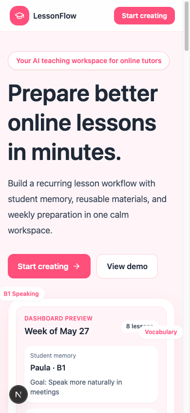

<p align="center">
  
</p>

# LessonFlow

A language-teacher workspace with student memory, lesson planning, reusable materials, weekly preparation and contextual AI generation.

## Preview


The local landing page includes an illustrative dashboard preview. This is not a capture of an authenticated teacher workspace.

<!-- Future screenshots: authenticated workspace with fictional demo data only.
Student context, lesson planner, materials library.
Add verified captures here; do not insert broken image paths or real records. -->

[](https://github.com/Fernise/lessonflow-app/actions/workflows/ci.yml)

**Technology:** Next.js · React · TypeScript · Tailwind CSS · Supabase · jsPDF

[Overview](#what-it-does) · [Quick start](#quick-start) · [Architecture](docs/ARCHITECTURE.md) · [Verification](docs/VERIFICATION.md)

## What it does

For language teachers who want lesson preparation to build on what they already know about each student.

- Student profiles, learning goals and structured teaching memory.
- Lesson planning with completion, saved materials and weekly preparation.
- Student-aware AI generation for speaking, vocabulary, quizzes and listening.
- Supabase authentication/RLS, a reusable materials library and PDF export.

## Screenshots

<details>
<summary>Mobile view</summary>



The actual landing page, including its illustrative dashboard. Authenticated workspace captures remain pending.

</details>

## Project status

MVP software for configured teacher workspaces. Database, authentication, OAuth and AI integrations require the operator’s own accounts. The public edition removes personal administrator identities and uses a server-managed feedback-admin claim.

## Quick start

Requires Node.js 22 through 26 and a separate Supabase development project.

```sh
git clone https://github.com/Fernise/lessonflow-app.git
cd lessonflow-app
npm ci
cp .env.example .env.local
```

Apply `database/schema.sql` to a new isolated Supabase project. Configure your own `NEXT_PUBLIC_SUPABASE_URL` and public anonymous/publishable client key in `.env.local`; never use a service-role credential in browser configuration.

```sh
npm run dev
```

Open `http://localhost:3000`. Configure `OPENAI_API_KEY` server-side for real generation. With `MOCK_OPENAI=true`, generation uses mock content but still requires a valid authenticated workspace. Optional listening-provider, analytics and email configuration are documented in [configuration](docs/CONFIGURATION.md).

The public edition upgrades Next.js to the patched 15.5 release line and updates async request interfaces. This source update is separate from any existing hosted deployment.

## Verification

```sh
npm test
npm run lint
npm run typecheck
npm run build
```

Unit tests cover generation contracts, CEFR adaptations, student-memory behavior and the feedback administration boundary. A full authenticated Supabase/OAuth exercise requires isolated configured services and is not claimed by these unit checks.

## Repository map

| Path | Responsibility |
| --- | --- |
| `src/app/` | Public pages, protected workspace, server actions and API routes |
| `src/components/` | Student, lesson, generation and materials UI |
| `src/lib/` | Auth, Supabase data access, generation and teaching logic |
| `database/` | Fresh schema, incremental migrations and inspection SQL |
| `tests/` | Offline generation and access regressions |
| `docs/` | Setup, architecture and listening examples |

## Documentation

- [Verification record and limits](docs/VERIFICATION.md)
- [Architecture and data boundaries](docs/ARCHITECTURE.md)
- [Configuration](docs/CONFIGURATION.md)
- [Security policy](SECURITY.md)
- [Contribution guidance](CONTRIBUTING.md)
- [Third-party notices](THIRD_PARTY_NOTICES.md)

## License

All rights reserved. See [LICENSE](LICENSE).

Third-party libraries and assets retain their own licenses.
